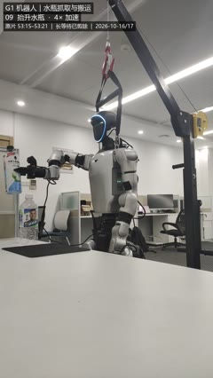

# G1 LLM Manipulation

LLM-assisted tabletop manipulation on Unitree G1 with Dex1-1 grippers.

[中文说明](README_zh.md) · [Architecture](docs/architecture.md) · [Setup and reproduction](docs/setup.md) · [Source guide](docs/source_guide.md) · [Verification](docs/verification.md)

This research-source release combines control programs, an operational prompt library, selected experiment evidence and annotated demonstrations. It documents how an LLM uses visual and joint feedback to plan and revise staged robot actions, while Python performs calculations and orchestration and C++ maintains the control loop.

It is a collection of research implementations and historical execution snapshots, rather than a trained general-purpose policy or a single portable runtime. Historical paths and device assumptions remain in source snapshots. Do not replay historical targets on a newly connected robot.

## Recorded results

| Task | Observed result |
|---|---|
| Lift and return a bottle | Small lift, replacement and withdrawal completed |
| Bottle to mousepad | Transport, upright release and return near the starting posture completed |
| A4 paper transport | Grasp, transport, release and normal exit completed in one run; paper only partly on the mat |
| Pouring | Not completed; no actual pouring performed |
| Cap opening | Limited unloaded dual-arm/gripper tests; actual cap opening not performed |

These are results from specific recorded runs, not benchmark success rates. The main hardware setup used fully load-bearing suspension and debug-position low-level control. Geometry approximations, calibration gaps and recovery limitations are described in the [prompt library](prompts/README.md).

## Demonstrations

- [Bottle to mousepad, uniform 4×](demos/bottle_to_mousepad/demo_4x.mp4): 3:56, portrait, silent; observation/waiting intervals removed. [Initial](demos/bottle_to_mousepad/initial.jpg), [lift](demos/bottle_to_mousepad/lift.jpg), [final](demos/bottle_to_mousepad/final.jpg).
- [Partial paper placement, uniform 4×](demos/paper_partial_placement/demo_4x.mp4): 1:23, silent; the partial placement outcome is retained.



Edited-video duration is not experiment duration. [Media notes](demos/README.md) describe the edits.

## Contents

- `robot_tools/`: shared and historical research programs.
- `experiments/bottle_to_mousepad/`: archived task sources, selected feedback audit and result evidence.
- `experiments/paper_partial_placement/`: later execution-source and orchestration snapshots.
- `prompts/`: sanitized, maintainable Chinese operational knowledge and task templates, including a generated standalone document.
- `docs/`: hardware assumptions, control architecture, dependencies, reproduction levels and source mapping.
- `configs/robot.example.json`: descriptive installation checklist; existing historical programs do not automatically consume it.
- `source_provenance.csv`: hashes before and after publishing transformations.

## Offline inspection

Python 3.11+ is sufficient for the standard-library release checker:

```bash
python tools/check_release.py
```

This checks files without importing task programs, connecting to hardware, starting a controller or replaying a trajectory. See [setup](docs/setup.md) for the separate robotics dependencies and build conditions. Static checks do not establish hardware readiness.

## License and sources

Original project contributions and original demonstration materials are released under the [MIT License](LICENSE). Manufacturer SDKs, third-party models, meshes and libraries are not bundled or relicensed. See [third-party notices](THIRD_PARTY_NOTICES.md).
