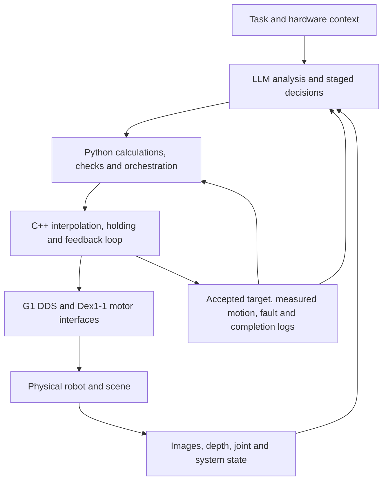

# Control architecture and validation

The LLM works through tools and source/configuration artifacts. It chooses stages and revises proposals using observations. Python generates and checks candidate geometry/paths, prepares phase targets and supervises acceptance and feedback. C++ executes interpolation, publishes control messages and maintains feedback/holding behavior independently of LLM inference intervals.

Historical single-arm tasks may still publish commands for all 29 body joints: the selected arm moves while other joints receive holding targets, gains and feedforward according to that controller. Gripper control is separate from the body DDS publisher. Inspect the selected implementation before drawing conclusions about its joint set, torque policy or stop behavior.

The later paper-body snapshot schedules a 2ms loop; this is a source-level scheduling target, not a measured guarantee or an LLM call frequency. A task-stage request, individual trajectory sample and complete LowCmd packet are different units.

Reading state, starting a holding controller, releasing a mode and stopping publication have different effects. Programs named guard/probe are not necessarily passive. Source snapshots retain their original execution gates and recovery behavior; no script should be assumed passive from its filename.

Validation layers are separate: static syntax and data checks; offline planning/build checks; target acceptance; measured joint response; external visual outcome; supported release/return/exit. Passing one does not imply the next. Known issues include approximate geometry/calibration, thermal load during long holds, incomplete collision coverage and recovery branches without entity-level validation. Detailed context is in the prompt library.
